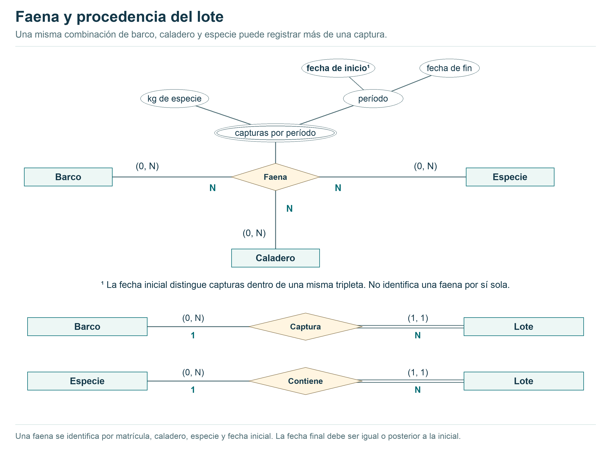
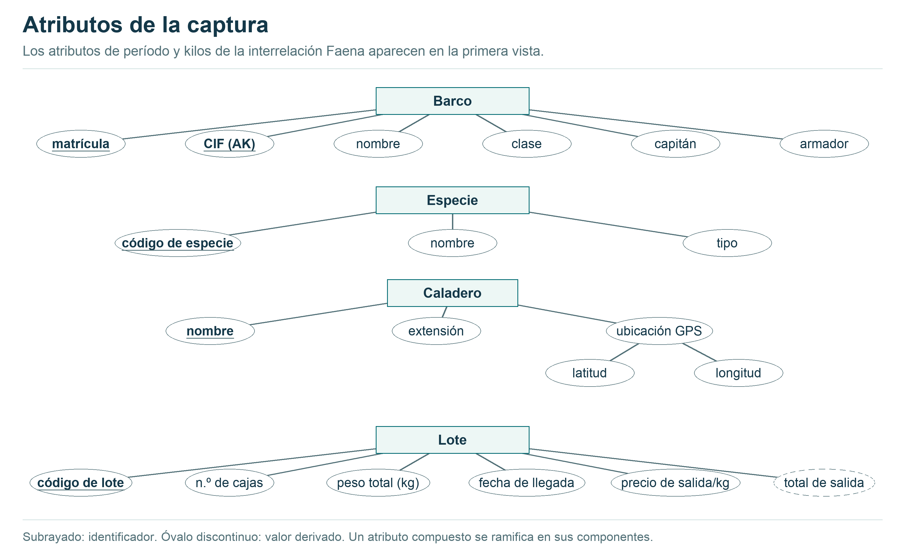
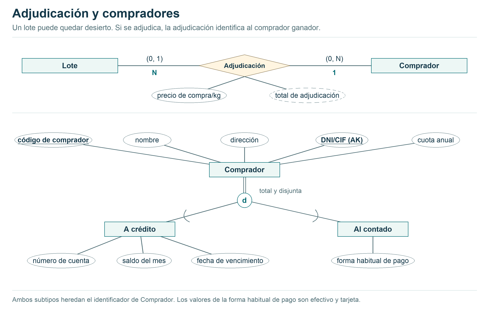
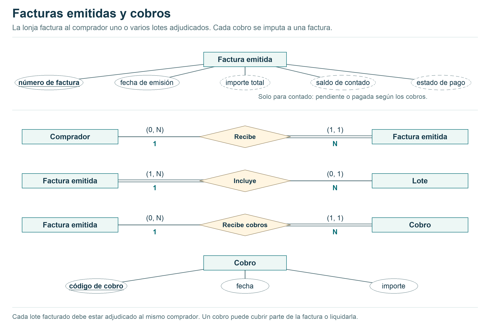
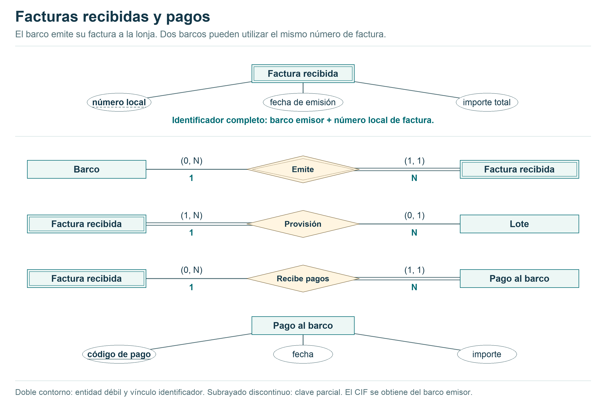

# Modelo conceptual de la lonja

Las cinco vistas representan el mismo modelo. Las entidades repetidas mantienen su identidad entre vistas. La pareja junto a cada entidad expresa el mínimo y el máximo de veces que una ocurrencia de esa entidad participa en la relación. [Decisiones del diseño y transformación al relacional](Lonja1.md)

Las figuras siguen el Tema II de Fundamentos de Bases de Datos (pp. 11–12 y 16–19). El subrayado continuo identifica una clave candidata y el discontinuo, la clave parcial de una entidad débil. El doble óvalo indica un atributo multivaluado. Las ramas de un atributo compuesto conducen a sus componentes y el contorno discontinuo distingue un atributo derivado. La línea doble expresa participación total. La negrita facilita la lectura de las etiquetas. En el modelo relacional de Visio, la negrita de un campo indica que su valor es obligatorio (Tema III, p. 21).

## Captura y procedencia

Cada lote procede de un solo barco y contiene una sola especie. Un barco o especie recién dado de alta puede tener todavía cero lotes. El caladero se identifica por su nombre y su ubicación se descompone en latitud y longitud.

En la ternaria **FAENA** intervienen barco, caladero y especie. Fijados barco y caladero, puede haber varias especies. Fijados barco y especie, puede haber varios caladeros. Fijados caladero y especie, pueden intervenir varios barcos. Esto da la cardinalidad N:N:N. La participación individual de cada entidad es (0,N), pues puede darse de alta antes de su primera faena.

Para una misma terna se conserva cada captura del período con su fecha de inicio, fecha de fin y kilos. Un período que empieza el lunes y otro que empieza el jueves son dos observaciones distintas, cada una con sus propios kilos. La fecha de inicio distingue las observaciones dentro de la terna. El fin debe ser igual o posterior al inicio. [Transformación de FAENA](Schema/Faenaje.md)

## Atributos e identificadores

El código del lote y el de la especie identifican sus respectivas entidades. En el barco son únicos la matrícula y el CIF. Los datos de llegada y los precios de salida pertenecen al lote. Los kilos capturados en una faena corresponden a su período. Los precios de compra se conocen al adjudicar. [Lotes](Schema/Lotes.md) · [Especies](Schema/Especies.md) · [Barcos](Schema/Barcos.md) · [Caladeros](Schema/Caladeros.md)

## Compradores y subasta

**COMPRADOR** se especializa de forma total y disjunta. Cada comprador es de crédito o de contado. El primero aporta cuenta bancaria, último importe acumulado y vencimiento del mes en curso. El segundo aporta su forma habitual de pago, efectivo o tarjeta.

En **ADJUDICACION** el lote participa (0,1) y el comprador (0,N). Si el lote queda sin adjudicar, carece de ganador y de precio de adjudicación. Si se adjudica, se consignan el ganador, el precio de compra por kilo y el total. [Compradores](Schema/Compradores.md) · [Adjudicación](Schema/Adjudicación.md)

## Factura emitida y cobro

La lonja emite cada factura a un único comprador. Un comprador puede recibir (0,N) facturas. Cada factura incluye (1,N) lotes adjudicados a ese comprador. Cada lote puede figurar en (0,1) facturas emitidas. Un lote recién adjudicado puede estar aún por facturar.

Cada **VENTA** registra un cobro de la lonja asociado a una única factura emitida. La factura puede originar (0,N) cobros. Para un comprador de contado se obtiene el estado pendiente o pagada del saldo que queda tras esos cobros. [Facturas emitidas y cobros](Schema/Facturas.md)

## Factura recibida y pago al barco

Cada factura recibida procede de un único barco y se identifica por su emisor y número. Un barco puede emitir (0,N) facturas. Se supone que cada factura recibida enumera (1,N) lotes del barco. Cada lote puede figurar en (0,1) facturas recibidas, con independencia de si la lonja ya lo ha facturado al comprador.

Cada **PAGO_BARCO** registra un pago de la lonja por una única factura recibida. La factura puede originar (0,N) pagos. El CIF se conoce a través del barco emisor. [Facturas recibidas y pagos](Schema/Facturas_Proveedor.md)
