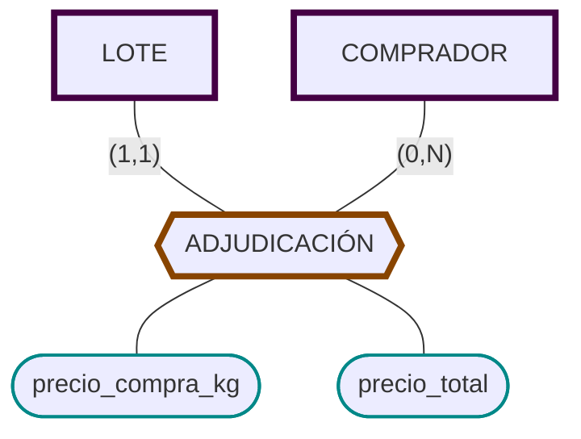

# Adjudicación

Los lotes se subastan. Cada lote será adquirido por el comprador que realice la mejor puja. 
- [x] Adjudicación 
  - [x] Precio de compra por kilo
  - [x] Precio total de adjudicación del lote
  - [x] Cada lote será adquirido por __un__ comprador.
  - [x] Un comprador puede adquirir varios lotes


```sql
CREATE TABLE ADJUDICACION (
    cod_lote            CHAR(5) PRIMARY KEY
                        REFERENCES LOTE,
    cod_comprador       CHAR(5) NOT NULL
                        REFERENCES COMPRADOR,
    precio_kg		    NUMBER(8,2),
    precio_total		NUMBER(8,2)
	);

```
`cod_lote` es PK porque cada lote solo puede venderse una vez. Cada Lote tiene una Adjudicación exacta.

`cod_comprador` es NOT NULL porque cada lote debe adjudicarse a alguien. Si no se adjudica, no se añade a la tabla. 


Si se modelara la subasta completa, sería necesario realizar la tabla que sería resultado de esa relación. Dentro de la dinámica de 'minimizar a lo necesario', no creo que sea rentable a largo plazo guardar todas las pujas en una base de datos a la larga, ya que su relevancia se esfuma en el momento de la adjudicación. Además, debido a la gran cantidad de pujas por subasta, esto aumentaría las necesidades materiales (memoria y procesamiento) exponencialmente. Esto encarecería el proyecto, su construcción y mantenimiento. 

Esta decisión debería ser secundada por el cliente. Si les interesa hacer este registro, con el coste asociado en memoria y trabajo, se puede implementar una tabla que tendría parametros adecuados (cod_lote, cod_comprador, puja) para seleccionar una puja ganadora. 

> Nota: A falta del simbolo en el software para tabla-relación, se ha usado un tag hexagonal largo, ya que su forma recuerda a la conjunción del rectángulo y el rombo.
