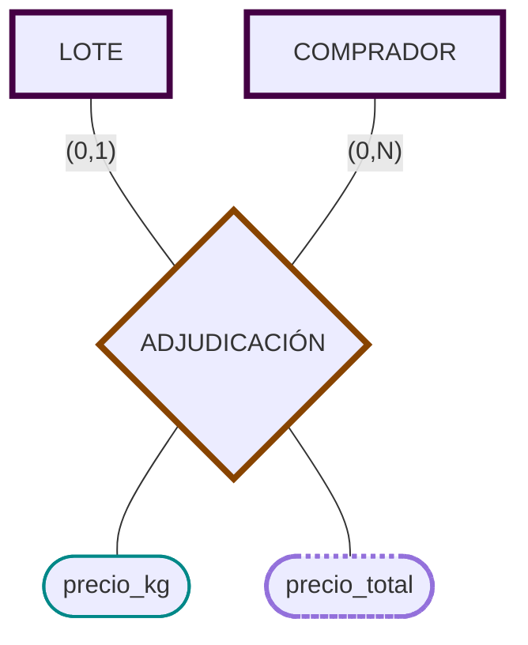

# Adjudicación

Los lotes se subastan. Si un lote se adjudica, lo adquiere el comprador que realiza la mejor puja.
- [x] Precio de compra por kilo
- [x] Precio total de adjudicación del lote
- [x] Cada lote puede quedar sin adjudicar o ser adquirido por __un__ comprador.
- [x] Un comprador puede adquirir varios lotes


```sql
CREATE TABLE ADJUDICACION (
    cod_lote      CHAR(5) PRIMARY KEY REFERENCES LOTE (cod_lote),
    cod_comprador CHAR(5) NOT NULL REFERENCES COMPRADOR (cod_comprador),
    precio_kg     NUMBER(8,2) NOT NULL CHECK (precio_kg >= 0),
    precio_total  NUMBER(8,2) NOT NULL CHECK (precio_total >= 0),
    UNIQUE (cod_lote, cod_comprador)
    );
```

`cod_lote` es PK porque un lote sólo puede venderse una vez. Si queda desierto, no se inserta una adjudicación. Toda adjudicación identifica a un comprador y conserva el precio por kilo y el total de compra.

El precio total se calcula multiplicando los kilos del lote por el precio de compra por kilo y redondeando a céntimos. El esquema almacena el resultado. Una corrección de peso o precio requiere recalcularlo.

La pareja de lote y comprador sirve de destino a la clave ajena de INCLUYE. Así una factura emitida sólo admite lotes ganados por su titular.

Se conserva la decisión de registrar la puja ganadora mediante la adjudicación. Las pujas perdedoras y su orden quedan fuera del modelo. Por tanto, no se puede reconstruir la subasta ni verificar después que la puja registrada fue la mejor. Si el cliente requiere esa auditoría, haría falta identificar y registrar cada puja.
