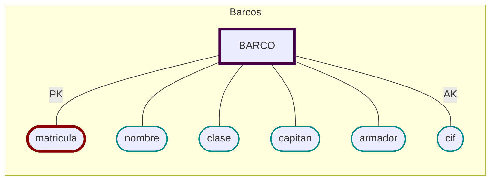

# Barcos
  - [x]  🔐 Matrícula
  - [x]  Nombre
  - [x]  Clase
  - [x]  Nombre del capitán
  - [x]  Nombre del armador
  - [x]  CIF


```sql
CREATE TABLE BARCO (
    matricula     CHAR(10) PRIMARY KEY,
    nombre        VARCHAR(30) NOT NULL,
    clase         VARCHAR(20) NOT NULL,
    capitan       VARCHAR(30) NOT NULL,
    armador       VARCHAR(30) NOT NULL,
    cif       	  VARCHAR(15) NOT NULL UNIQUE
    );
```

La matrícula identifica al barco y el CIF constituye una clave alternativa obligatoria. Se conserva como texto para admitir letras y ceros iniciales.
