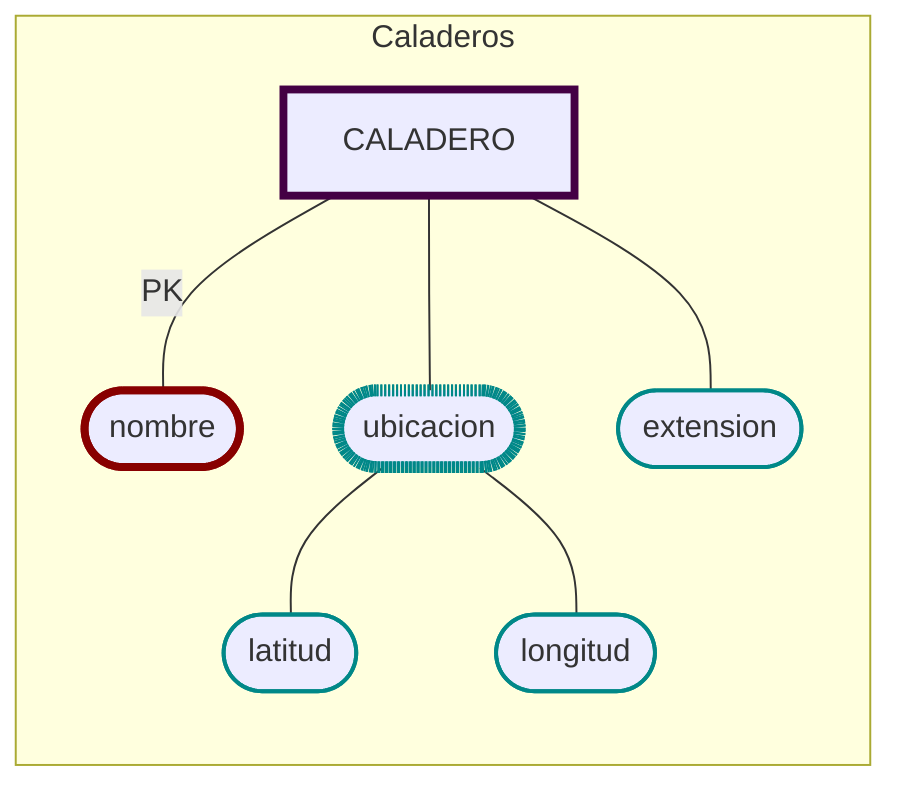

# Caladeros
  - [x]  🔐 __Nombre__ (único),
  - [x]  Extensión
  - [x]  Ubicación [GPS]
      - [x]  latitud 
      - [x]  longitud.


```sql
CREATE TABLE CALADERO (
    nombre        VARCHAR(40) PRIMARY KEY,
    extension     NUMBER(10,2) NOT NULL CHECK (extension > 0),
    latitud       NUMBER(8,5) NOT NULL CHECK (latitud BETWEEN -90 AND 90),
    longitud      NUMBER(8,5) NOT NULL CHECK (longitud BETWEEN -180 AND 180)
    );
```

La ubicación es un atributo compuesto por latitud y longitud en grados decimales. Se supone que la extensión se mide en km².
