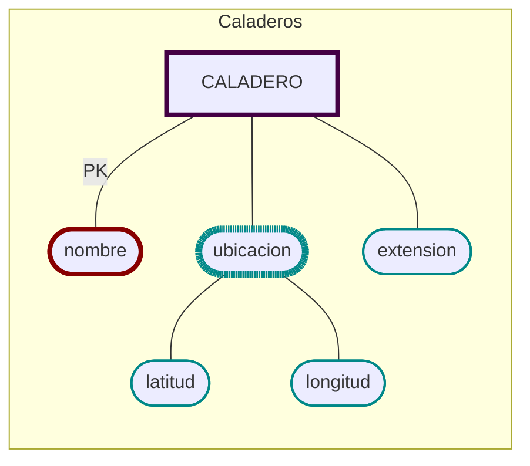

# Caladeros
  - [x]  🔐 __Nombre__ (único),
  - [x]  Extensión
  - [x]  Ubicación [GPS]
      - [x]  latitud 
      - [x]  longitud.
      - [ ]  

```sql
CREATE TABLE CALADERO (
    nombre        VARCHAR(40) PRIMARY KEY,
    extension     NUMBER(10,2),
    latitud       NUMBER(8,5),
    longitud      NUMBER(8,5)
    );
```
