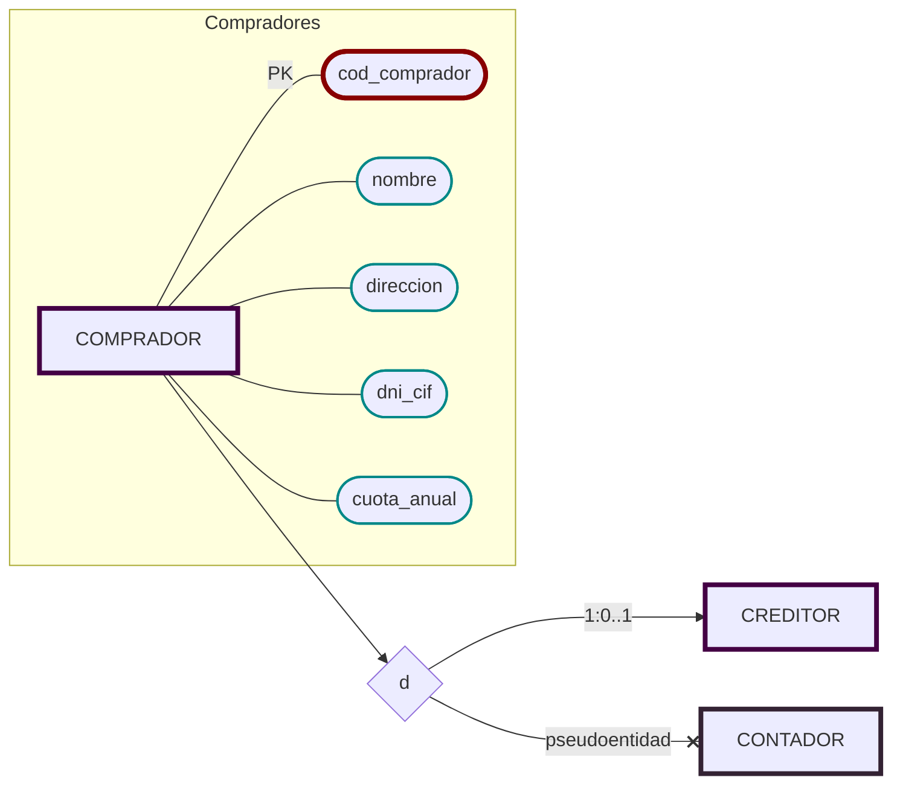

# Compradores

- [x]  🔐 __Código__ (no repetible),
- [x]  Nombre,
- [x]  Dirección,
- [x]  DNI o CIF,
- [x]  Cuota anual que deben pagar a la lonja.

## Creditores y Contadores
Existen compradores de dos tipos
---
1. ### A Credito (Creditores)
   Que tienen crédito, realizando los pagos al final de cada mes:
  - [] Número de cuenta bancaria (IBAN).
  - [] Importe acumulado hasta el momento.
  - [] Fecha de vencimiento del pago.
  ---
2. ### Al contado (Contadores)
  - [] No se requiere información adicional
  ---

> Un comprador no puede ser de ambos tipos a la vez.

