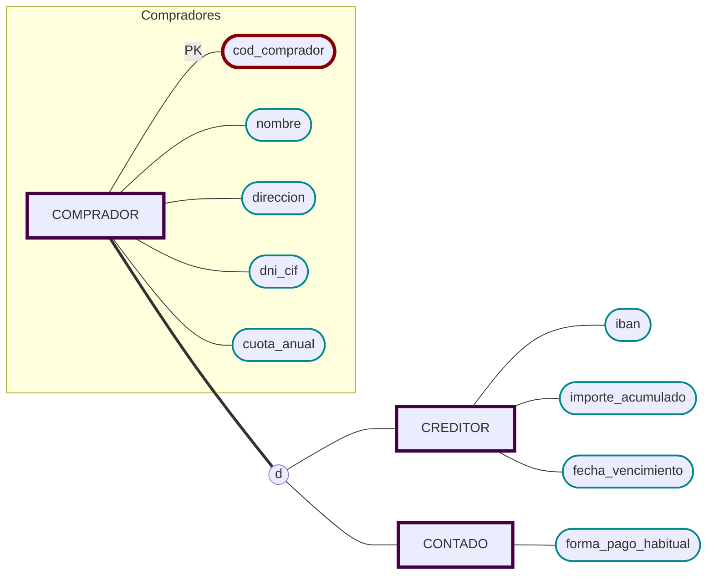

# Compradores

- [x]  🔐 __Código__ (no repetible),
- [x]  Nombre,
- [x]  Dirección,
- [x]  DNI o CIF,
- [x]  Cuota anual que deben pagar a la lonja.



## Compradores a crédito y al contado

La especialización es disjunta por enunciado. Se supone cobertura total porque las dos modalidades descritas agotan las formas de liquidación de los compradores.

- CREDITOR conserva la cuenta, el importe acumulado y el vencimiento de la mensualidad en curso.
- CONTADO conserva la forma habitual de pago, efectivo o tarjeta. Una compra concreta puede estar pendiente aunque la modalidad habitual sea al contado.

```sql
CREATE TABLE COMPRADOR (
    cod_comprador CHAR(5) PRIMARY KEY,
    nombre        VARCHAR(40) NOT NULL,
    direccion     VARCHAR(60) NOT NULL,
    dni_cif       VARCHAR(15) NOT NULL UNIQUE,
    cuota_anual   NUMBER(8,2) NOT NULL CHECK (cuota_anual >= 0)
    );

CREATE TABLE CREDITOR (
    cod_comprador     CHAR(5) PRIMARY KEY REFERENCES COMPRADOR (cod_comprador),
    iban              CHAR(24) NOT NULL,
    importe_acumulado NUMBER(10,2) DEFAULT 0 NOT NULL CHECK (importe_acumulado >= 0),
    fecha_vencimiento DATE NOT NULL
    );

CREATE TABLE CONTADO (
    cod_comprador       CHAR(5) PRIMARY KEY REFERENCES COMPRADOR (cod_comprador),
    forma_pago_habitual VARCHAR(8) NOT NULL
                        CHECK (forma_pago_habitual IN ('efectivo', 'tarjeta'))
    );
```

El código es la PK del comprador y se hereda como PK y FK en cada subtipo. Las FK exigen que exista el comprador. Para exigir exactamente un subtipo hay que validar en la misma operación el alta o cambio de modalidad, incluidos ambos subtipos. Las dos claves por sí solas permiten tanto la doble pertenencia como la ausencia de subtipo.

Se conserva la unicidad de DNI/CIF como supuesto de identidad fiscal. El IBAN se guarda como texto para conservar letras y ceros iniciales. Los 24 caracteres suponen cuentas españolas.
