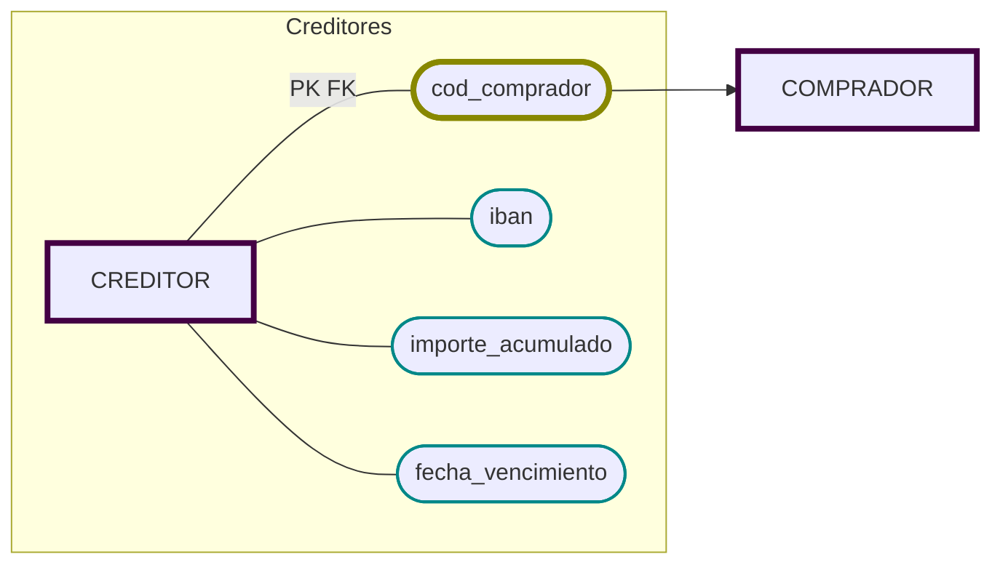

# Compradores

- [x]  🔐 __Código__ (no repetible),
- [x]  Nombre,
- [x]  Dirección,
- [x]  DNI o CIF,
- [x]  Cuota anual que deben pagar a la lonja.


## Compradores: Creditores y Contadores
Existen compradores de dos tipos
---
1. ### A Credito (Creditores)
   Que tienen crédito, realizando los pagos al final de cada mes:
  - [ ] Número de cuenta bancaria (IBAN).
  - [ ] Importe acumulado hasta el momento.
  - [ ] Fecha de vencimiento del pago.
  ---
2. ### Al contado (Contadores)
  - [ ] No se requiere información adicional
  ---

> - [ ] Un comprador no puede ser de ambos tipos a la vez.



#### 📝 Notas de Diseño:
- Tabla COMPRADOR: todos los compradores, sin distinguir.
- Tabla CREDITOR: solo los compradores que tienen crédito.
  - cod_comprador = PK y FK a COMPRADOR.

Implementación de _especialización por predicado_.

Sin tabla para contado. No es necesaria. Ambos grupos son excluyentes. Si está en  _creditor_, no es _contador_.

```sql
CREATE TABLE COMPRADOR (
    cod_comprador CHAR(5) PRIMARY KEY,
    nombre        VARCHAR(40),
    direccion     VARCHAR(60),
    dni_cif       VARCHAR(15) UNIQUE,
    cuota_anual   NUMBER(8,2)
    );

CREATE TABLE CREDITOR (
    cod_comprador     CHAR(5) PRIMARY KEY
                      REFERENCES COMPRADOR,
    iban              CHAR(24),
    importe_acumulado NUMBER(10,2),
    fecha_vencimiento DATE
    );
```

Suponemos que todo comprador que no aparece en CREDITOR opera al contado.
Por tanto: 
- Cada cod_comprador puede aparecer a lo sumo una vez en CREDITOR (PK).
- Si aparece: es crédito.
- No hay forma de que también sea de otro tipo, porque no hay otra subtabla.
- Disjunto garantizado.
- No hay basura ni nulos forzados.
- Contado = los que no están en CREDITOR
  -   Totalidad cubierta, sin necesidad de un atributo tipo

Un IBAN es un "número" de cuenta, pero contiene caracteres no numéricos (ES, FR, US...). Considero mejor guardarla como un CHAR de 24 caracteres. Se requerirá verificación. 


