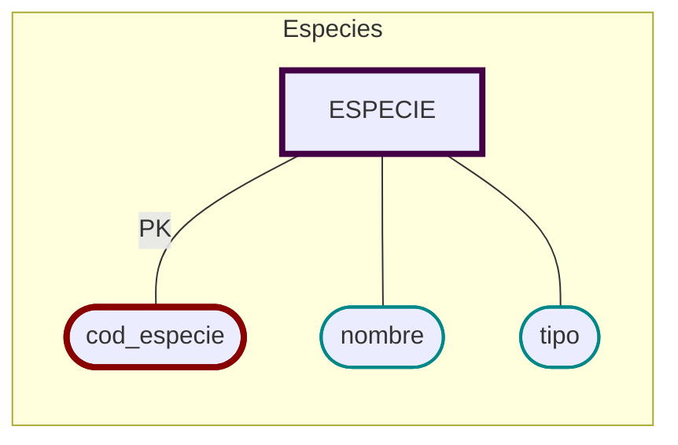

# Especies
  - [x]  🔐 __Código__ (no repetible)
  - [x]  Nombre
  - [x]  Tipo (por ejemplo, moluscos, pescado blanco, etc.).

```sql
CREATE TABLE ESPECIE (
    cod_especie   VARCHAR(5) PRIMARY KEY,
    nombre        VARCHAR(30),
    tipo          VARCHAR(20)
    );
```

