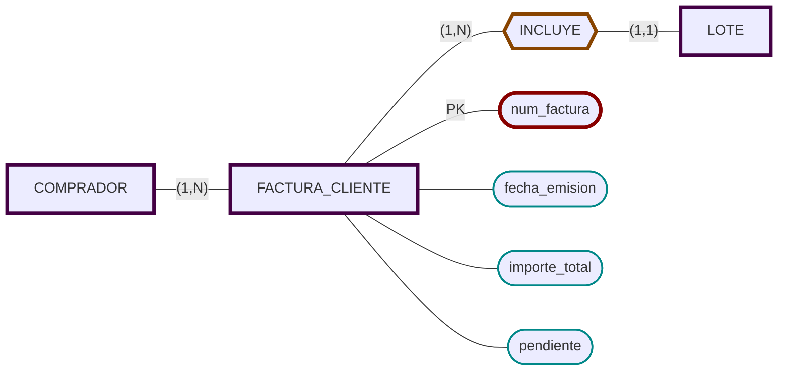

# FACTURAS (Lonja)


- [x] Facturas de Pagos (de los compradores por los lotes).
  - [x] Cada factura corresponde a un comprador.
  - [x] Una factura puede incluir uno o varios lotes.
  - [x] Número de factura
  - [x] Fecha de emisión
  - [x] Importe total.
  - [x] Estado (pendiente o pagada).
  - [x] Cada lote en exactamente una factura.
  - [x] Un comprador puede tener muchas facturas.
     




```sql
CREATE TABLE FACTURA_CLIENTE (
    num_factura      	CHAR(10) PRIMARY KEY,
    cod_comprador    	CHAR(5) NOT NULL REFERENCES COMPRADOR,
    fecha_emision    	DATE NOT NULL,
    importe_total    	NUMBER(10,2),
    pendiente         NUMBER(1,0) DEFAULT 0
			-- 1 = pendiente, 0 = pagada
);

CREATE TABLE INCLUYE (
    num_factura   CHAR(10) REFERENCES FACTURA_CLIENTE,
    cod_lote      CHAR(5)  REFERENCES LOTE UNIQUE,
    PRIMARY KEY (num_factura, cod_lote)
);

```
- INCLUYE es la relación N:M.
- PRIMARY KEY (num_factura, cod_lote) impide repetir un lote en la misma factura.

Estado Pagada: 
- 1 = pendiente (TRUE)
- 0 = pagada (FALSE)
- `DEFAULT 0` asegura que todas las facturas nuevas comiencen como pagadas, ya que es el default de las .
- Este campo actúa como booleano.
- Guardamos el estado para todas las facturas, aunque solo sea relevante para compradores al contado. Para el grupo que no es de interés se ponen como pagadas automaticamente.
  
Cada comprador puede emitir varias facturas; cada factura agrupa varios lotes.

Cada lote pertenece a una única factura (por post-adjudicación).


