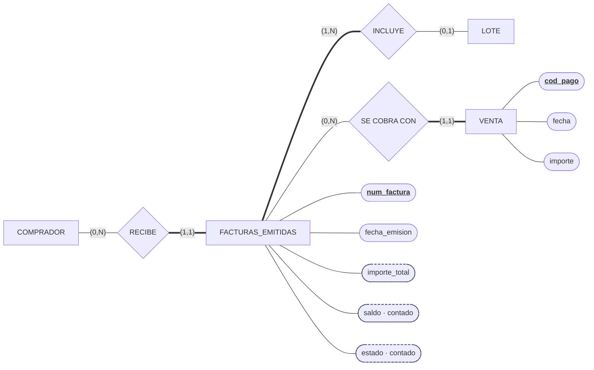

# Facturas emitidas por la lonja

- [x] Cada factura corresponde al comprador que ganó los lotes.
- [x] Incluye uno o varios lotes de ese comprador.
- [x] Se conservan número, fecha de emisión e importe total.
- [x] En ventas al contado interesa saber si la factura sigue pendiente o está pagada.
- [x] Cada cobro se imputa a una factura. Una factura puede recibir varios cobros parciales.



```sql
CREATE TABLE FACTURAS_EMITIDAS (
    num_factura   CHAR(10) PRIMARY KEY,
    cod_comprador CHAR(5) NOT NULL REFERENCES COMPRADOR (cod_comprador),
    fecha_emision DATE NOT NULL,
    importe_total NUMBER(10,2) NOT NULL CHECK (importe_total >= 0),
    UNIQUE (num_factura, cod_comprador)
    );

CREATE TABLE INCLUYE (
    cod_lote      CHAR(5) PRIMARY KEY,
    cod_comprador CHAR(5) NOT NULL,
    num_factura   CHAR(10) NOT NULL,
    FOREIGN KEY (num_factura, cod_comprador)
        REFERENCES FACTURAS_EMITIDAS (num_factura, cod_comprador),
    FOREIGN KEY (cod_lote, cod_comprador)
        REFERENCES ADJUDICACION (cod_lote, cod_comprador)
    );

CREATE TABLE VENTA (
    cod_pago    CHAR(5) PRIMARY KEY,
    num_factura CHAR(10) NOT NULL REFERENCES FACTURAS_EMITIDAS (num_factura),
    fecha       DATE NOT NULL,
    importe     NUMBER(10,2) NOT NULL CHECK (importe > 0)
    );
```

La lonja es el único emisor de este circuito. Se supone que su número identifica una factura emitida. Se conserva la denominación VENTA del modelo para los movimientos de cobro del comprador. La adjudicación identifica el resultado de la subasta.

INCLUYE representa una relación 1:N. El código de lote como PK impide incluirlo en dos facturas emitidas. Las dos FK comparten comprador, de modo que tampoco se puede facturar un lote desierto ni un lote ganado por otra persona. El lote puede seguir sin facturar mientras se prepara la factura. Al emitirla, una operación debe comprobar que tiene al menos una línea y que el importe total coincide con la suma de los precios totales de adjudicación de sus lotes.

### Saldo y estado al contado

Para una factura de 100 €, un cobro de 40 € deja un saldo pendiente de 60 €. Un segundo cobro de 60 € la deja pagada. Un abono mensual que cubra varias facturas a crédito se desglosa en una imputación VENTA por factura por la parte que corresponda. El modelo conserva la fecha y el importe imputado. Sin un identificador bancario adicional, no se puede reconstruir qué imputaciones proceden de una misma transferencia.

La consulta de Access `ESTADO_CONTADO` devuelve sólo facturas de compradores al contado. La suma de los cobros es cero si aún no hay movimientos. Un saldo cero significa «pagada» y uno positivo, «pendiente». Al registrar o modificar un cobro, o al rectificar el importe de la factura, se comprueba en la misma operación que el total imputado no supera el importe facturado. Esa regla abarca la cabecera y sus movimientos.

```sql
SELECT
    F.num_factura,
    F.importe_total - Nz(Sum(V.importe), 0) AS saldo,
    IIf(
        F.importe_total = Nz(Sum(V.importe), 0),
        'pagada',
        'pendiente'
        ) AS estado
FROM
    (FACTURAS_EMITIDAS AS F
     LEFT JOIN VENTA AS V
         ON F.num_factura = V.num_factura)
    INNER JOIN CONTADO AS C
        ON F.cod_comprador = C.cod_comprador
GROUP BY
    F.num_factura,
    F.importe_total;
```

El estado se obtiene a partir de los cobros. Una factura a crédito conserva sus imputaciones sin recibir el estado reservado al contado.
