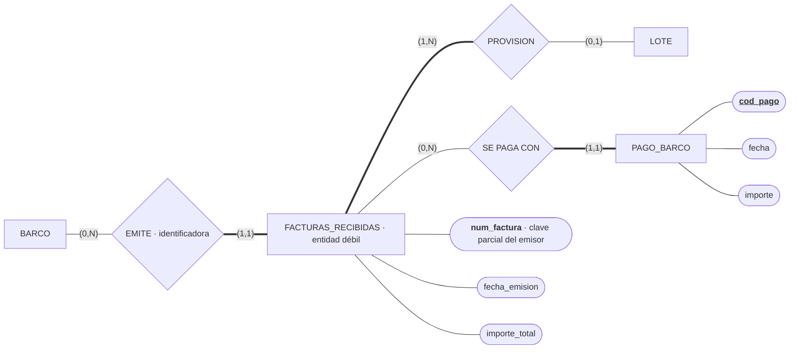

# Facturas recibidas de los barcos

- [x] Se conservan número de factura, fecha de emisión e importe total.
- [x] La matrícula identifica al barco emisor y permite recuperar su CIF.
- [x] Cada factura contiene uno o varios lotes capturados por ese barco.
- [x] Cada pago de la lonja al barco se imputa a una factura recibida.



La factura recibida es una entidad débil. Su número local es clave parcial. El rombo identificador la relaciona con el barco emisor. [Diagrama con doble contorno y subrayado discontinuo](../Diagramas/05-factura-recibida.png)

```sql
CREATE TABLE FACTURAS_RECIBIDAS (
    matricula     CHAR(10) NOT NULL REFERENCES BARCO (matricula),
    num_factura   CHAR(10) NOT NULL,
    fecha_emision DATE NOT NULL,
    importe_total NUMBER(10,2) NOT NULL CHECK (importe_total >= 0),
    PRIMARY KEY (matricula, num_factura)
    );

CREATE TABLE PROVISION (
    cod_lote    CHAR(5) PRIMARY KEY,
    matricula   CHAR(10) NOT NULL,
    num_factura CHAR(10) NOT NULL,
    FOREIGN KEY (matricula, num_factura)
        REFERENCES FACTURAS_RECIBIDAS (matricula, num_factura),
    FOREIGN KEY (cod_lote, matricula)
        REFERENCES LOTE (cod_lote, matricula_barco)
    );

CREATE TABLE PAGO_BARCO (
    cod_pago    CHAR(5) PRIMARY KEY,
    matricula   CHAR(10) NOT NULL,
    num_factura CHAR(10) NOT NULL,
    fecha       DATE NOT NULL,
    importe     NUMBER(10,2) NOT NULL CHECK (importe > 0),
    FOREIGN KEY (matricula, num_factura)
        REFERENCES FACTURAS_RECIBIDAS (matricula, num_factura)
    );
```

Cada barco numera sus propias facturas. Si dos emiten la factura 17, la matrícula distingue los documentos. El CIF se obtiene de BARCO, donde es obligatorio y único. Se supone estable durante el período documentado. Si hubiera que conservar el CIF histórico impreso después de un cambio fiscal, se necesitaría registrar su vigencia o una copia en la factura.

PROVISION comparte la matrícula entre las dos FK. Así sólo admite lotes del emisor y cada lote figura como máximo una vez en este circuito. Puede figurar también en una factura al comprador. Antes de dar por registrada una factura recibida hay que comprobar que contiene por lo menos un lote.

Puede haber varios pagos parciales o ninguno. El saldo del barco para esa factura es el importe total menos sus pagos. Al registrar o modificar un pago, o al rectificar el importe de la factura, se comprueba en la misma operación que la suma de los pagos no supera el importe facturado. El estado especial de las facturas a compradores al contado no interviene en este circuito.
