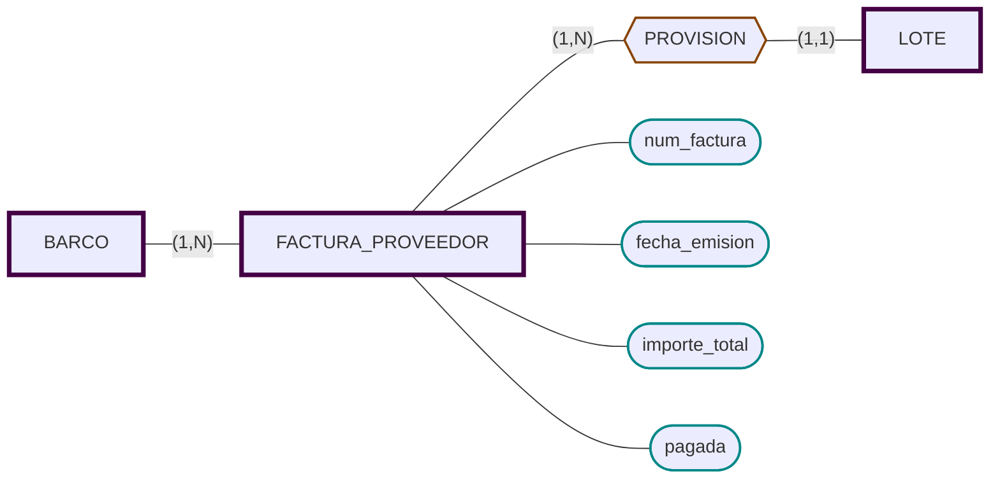

# Factura Proveedor
Las facturas emitidas por los barcos:
- Datos básicos:
  - Número de factura.
  - Fecha de emisión.
  - Importe total.
- El CIF del barco (desde matrícula).
- Los códigos de lote facturados.

Las facturas emitidas por los barcos,
- [x] Datos básicos
	- [x] Número de factura
	- [x] Fecha de emisión
	- [x] Importe total.
- [x] el CIF del barco (desde matricula)
- [x] Los códigos de lote facturados



```sql
CREATE TABLE FACTURA_PROVEEDOR (
    num_factura  		CHAR(10) PRIMARY KEY,
    matricula          	CHAR(10) NOT NULL REFERENCES BARCO,
    fecha_emision      	DATE NOT NULL,
    importe_total      	NUMBER(10,2),
    pagada             	NUMBER(1,0) DEFAULT 1
    -- 1 = pendiente, 0 = pagada
	);

CREATE TABLE PROVISION (
    num_factura  			CHAR(10) REFERENCES FACTURA_PROVEEDOR,
    cod_lote           		CHAR(5)  REFERENCES LOTE UNIQUE,
    PRIMARY KEY (num_factura, cod_lote)
	);

CREATE TABLE PAGO_BARCO (
    cod_pago      CHAR(5) PRIMARY KEY,
    num_factura   CHAR(10) REFERENCES FACTURA_PROVEEDOR,
    fecha         DATE,
    importe       NUMBER(10,2)
);
```
Aunque el enunciado dice que en la factura se almacena el CIF del barco, optamos por guardar el CIF como atributo del BARCO y referenciar el barco desde FACTURA_PROVEEDOR usando su clave actual. 

Así evitamos redundancia; el CIF es accesible mediante una consulta.
Otra alternativa sería cambiar la clave principal o hacer una compuesta. Al ser requisitos bastante separados, es posible que sea una confusión del cliente, ya que el campo cif no estaba requerido en la información del barco. Por tanto, técnicamente no está relacionando una entidad con otra añadir el cif a la factura. 

Considero que esta opción es la más sencilla, y que la interfaz puede presentar está información como el cliente prefiera. Antes de implementar esta decisión de diseño consultaría con el cliente.


