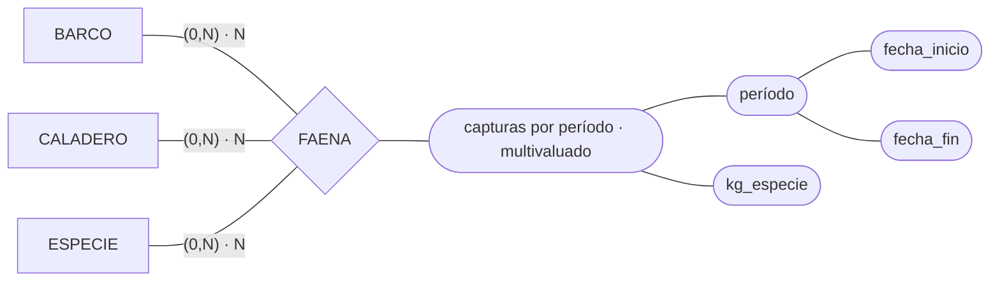

# Faenaje
- [x]  Faena
    - [x]  🔏 Un barco (matrícula)
    - [x]  🔏 En un caladero (nombre)
    - [x]  🔏 Una especie (código)
    - [x]  los kilos obtenidos de cada especie
    - [x]  en un intervalo de tiempo
        - [x]  una fecha (_timemark_) de inicio
        - [x]  y otra de fin.



La relación es ternaria N:N:N. Para un barco y un caladero puede haber varias especies, para un barco y una especie varios caladeros y para una especie y un caladero varios barcos. Los tres mínimos son cero porque se admite el alta previa a la primera faena.

Un mismo trío puede faenar en períodos distintos. Cada elemento del conjunto de capturas agrupa un período compuesto de inicio y fin con los kilos de esa ocurrencia. La fecha inicial distingue los períodos de una misma combinación.

```sql
CREATE TABLE FAENA (
    matricula_barco CHAR(10) NOT NULL REFERENCES BARCO (matricula),
    nombre_caladero VARCHAR(40) NOT NULL REFERENCES CALADERO (nombre),
    cod_especie     VARCHAR(5) NOT NULL REFERENCES ESPECIE (cod_especie),
    kg_especie      NUMBER(8,2) NOT NULL CHECK (kg_especie > 0),
    fecha_inicio    DATE NOT NULL,
    fecha_fin       DATE NOT NULL,
    PRIMARY KEY (matricula_barco, nombre_caladero, cod_especie, fecha_inicio),
    CHECK (fecha_fin >= fecha_inicio)
    );
```

Puede haber dos faenas del mismo trío iniciadas en días distintos, incluso si el peso coincide. El barco y la especie de un lote no bastan para atribuirlo a un caladero ni a un período concreto.
