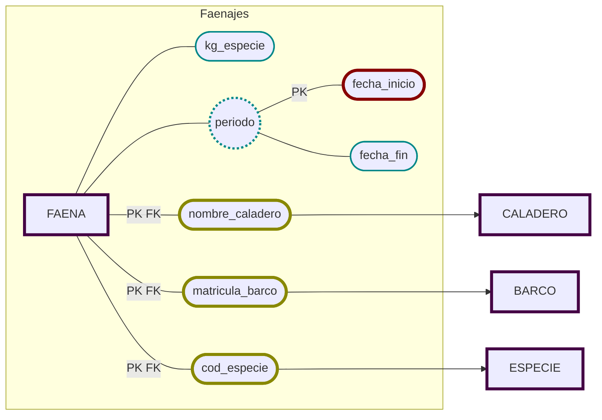

# Faenaje
- [x]  Faena
    - [x]  🔏 Un barco (matrícula)
    - [x]  🔏 En un caladero (nombre)
    - [x]  🔏 Una especie (código)
    - [x]  los kilos obtenidos de cada especie
    - [x]  en un intervalo de tiempo
        - [x]  una fecha (_timemark_) de inicio
        - [x]  y otra de fin.


```sql
CREATE TABLE FAENA (
    matricula_barco CHAR(10)   REFERENCES BARCO,
    nombre_caladero VARCHAR(40) REFERENCES CALADERO,
    cod_especie     VARCHAR(5) REFERENCES ESPECIE,
    kg_especie 		NUMBER(8,2),
    fecha_inicio    DATE,
    fecha_fin       DATE,
    PRIMARY KEY (matricula_barco, nombre_caladero, cod_especie, fecha_inicio)
    );
```


> Idea Alternativa:
> En lugar de relacionar Barco Especie y Caladero a tres
> Relacionar Lotes y Caladeros. Razones:
> - Lotes ya tiene el barco y la cantidad 
> 
