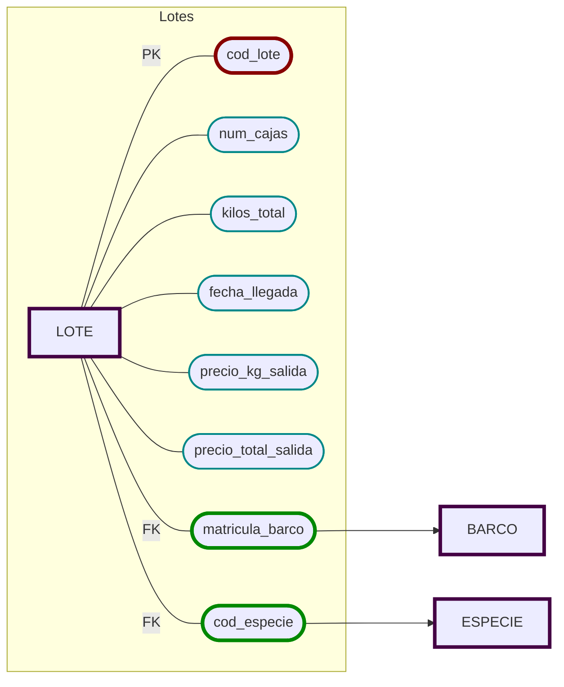

# Lotes

La captura del día se distribuye en **Lotes**:
- [x] Código único
- [x] Número de cajas
- [x] Una determinada especie
- [x] Número de kilos total
- [x] Fecha de llegada
- [x] Precio por kilo de salida
- [x] Precio total de salida del lote
- [x] **Qué barco capturó cada lote**

      

```sql
CREATE TABLE LOTE (
    cod_lote            CHAR(5) PRIMARY KEY,
    num_cajas           NUMBER(6,0) NOT NULL CHECK (num_cajas > 0),
    kilos_total         NUMBER(8,2) NOT NULL CHECK (kilos_total > 0),
    fecha_llegada       DATE NOT NULL,
    precio_kg_salida    NUMBER(8,2) NOT NULL CHECK (precio_kg_salida >= 0),
    precio_total_salida NUMBER(8,2) NOT NULL CHECK (precio_total_salida >= 0),
    cod_especie         VARCHAR(5) NOT NULL REFERENCES ESPECIE (cod_especie),
    matricula_barco     CHAR(10) NOT NULL REFERENCES BARCO (matricula),
    UNIQUE (cod_lote, matricula_barco)
    );
```

La pareja de lote y matrícula permite comprobar que el emisor de una factura recibida es el barco que capturó ese lote. El código del lote sigue siendo por sí solo su identificador.
